# ER diagram (database schema)

The PostgreSQL schema as migrated, in the same order as `apps/api/prisma/schema.prisma` (the source of truth). Renders on GitHub.

```mermaid
erDiagram
    USER {
        uuid id PK
        string email UK "domain-checked, lowercase"
        string name
        string password_hash
        enum role "STUDENT, POC, SUPER_ADMIN"
        string enrollment_id "students, from email local part"
        timestamp email_verified_at
        timestamp deactivated_at "set when a person is removed from their last role: they can no longer log in"
        timestamp created_at
    }
    CATEGORY {
        uuid id PK
        string name UK "e.g. Hostel & Accommodation"
        string short_name "chip and team label, e.g. Hostel"
        int sort_order
        int max_level "highest escalation level"
        boolean active "retired categories are hidden, not deleted"
    }
    SUB_CATEGORY {
        uuid id PK
        uuid category_id FK
        string name "unique within its category"
        int sort_order
        boolean active
    }
    POC_ASSIGNMENT {
        uuid id PK
        uuid user_id FK
        uuid category_id FK
        int level "1, 2, 3..."
        uuid manager_assignment_id FK "the L(n+1) POC who oversees this one"
        boolean active
        boolean on_leave
        timestamp on_leave_until "leave ends by itself on this date"
    }
    TICKET {
        uuid id PK
        string title
        text description
        uuid category_id FK
        uuid sub_category_id FK "what exactly the issue is about"
        uuid student_id FK
        enum priority "LOW, MEDIUM, HIGH"
        enum status "CREATED, ASSIGNED, IN_PROGRESS, ESCALATED, RESOLVED (shown as Solved), CLOSED, REOPENED"
        int current_level
        int resolved_level "set on resolve, used on reopen"
        uuid assigned_poc_id FK "nullable, internal only"
        timestamp tat_deadline
        timestamp tat_warned_at "when the 12-hours-left warning went out for this deadline"
        boolean critical "the top level did not solve it within the time limit"
        boolean closed_by_student "the student closed it themselves; not a POC outcome"
        uuid parent_ticket_id FK "reserved for duplicate linking; not used yet"
        timestamp created_at
        timestamp updated_at
        timestamp resolved_at
    }
    TICKET_EVENT {
        uuid id PK
        uuid ticket_id FK
        enum type "CREATED, ASSIGNED, COMMENTED, STATUS_CHANGED, ESCALATED, TAT_BREACHED, NUDGED, RESOLVED, CLOSED, REOPENED, LINKED, UNLINKED, REASSIGNED, CLOSED_BY_STUDENT, RENAMED"
        uuid actor_id FK "null for system"
        uuid assignee_id FK "who the ticket went to (ASSIGNED, ESCALATED, REOPENED)"
        enum from_status
        enum to_status
        int from_level
        int to_level
        enum visibility "PUBLIC, INTERNAL"
        enum reason "on ESCALATED: MANUAL, TAT_BREACH, ON_LEAVE"
        text note "e.g. POC unavailable"
        timestamp created_at
    }
    TICKET_FEEDBACK {
        uuid id PK
        uuid ticket_id FK
        uuid student_id FK
        uuid finish_event_id FK "the Solved or Closed event answered; one answer per finish"
        enum rating "SATISFIED, OKAY, NOT_SATISFIED"
        text comment
        uuid finished_by_id FK "the POC credited"
        int finished_level
        uuid category_id FK
        timestamp created_at
    }
    COMMENT {
        uuid id PK
        uuid ticket_id FK
        uuid author_id FK
        uuid parent_comment_id FK "nullable, threading"
        text body
        enum visibility "PUBLIC, INTERNAL"
        timestamp created_at
    }
    COMMENT_MENTION {
        uuid comment_id FK
        uuid mentioned_user_id FK
    }
    ATTACHMENT {
        uuid id PK
        uuid ticket_id FK
        uuid comment_id FK "nullable"
        uuid uploader_id FK
        string storage_key "random object key"
        string file_name
        string mime_type
        bigint size_bytes
        enum scan_status "PENDING, CLEAN, INFECTED"
        timestamp created_at
    }
    NOTIFICATION {
        uuid id PK
        uuid user_id FK
        enum type "STATUS_CHANGE, COMMENT, MENTION, ESCALATION, RESOLVED, NUDGE, NEW_TICKET, TAT_WARNING, TAT_MISSED, CRITICAL"
        uuid ticket_id FK
        uuid comment_id FK "nullable, deep link"
        timestamp read_at
        timestamp emailed_at "outbox: null until sent"
        timestamp created_at
    }
    STAFF_AUDIT {
        uuid id PK
        uuid actor_id FK "who made the change"
        string action "ADDED, UPDATED, REMOVED, LEAVE_ON, LEAVE_OFF, INVITE_SENT, CATEGORY_ADDED, CATEGORY_UPDATED, CATEGORY_REMOVED, CATEGORY_RESTORED, TOPIC_ADDED, TOPIC_UPDATED, TOPIC_REMOVED, TOPIC_RESTORED"
        uuid target_user_id FK "nullable"
        uuid category_id "nullable"
        string summary "readable, e.g. Added Ravi as L1"
        timestamp created_at
    }
    ADMIN_NOTE {
        uuid id PK
        uuid author_id FK "the Super Admin"
        text body
        string audience "in words, e.g. Hostel - L2"
        string context "what the admin was looking at"
        timestamp created_at
    }
    ADMIN_NOTE_RECEIPT {
        uuid note_id PK, FK
        uuid user_id PK, FK
        timestamp seen_at "null until opened"
    }
    REFRESH_TOKEN {
        uuid id PK
        uuid user_id FK
        string token_hash
        timestamp expires_at
        timestamp revoked_at
    }
    APP_SETTING {
        string key PK "for example escalation_hours"
        string value
        timestamp updated_at
        uuid updated_by_id
    }
    JOB_HEARTBEAT {
        string job_name PK
        timestamp last_run_at
    }

    USER ||--o{ POC_ASSIGNMENT : "has"
    CATEGORY ||--o{ POC_ASSIGNMENT : "staffed by"
    POC_ASSIGNMENT |o--o{ POC_ASSIGNMENT : "manages"
    USER ||--o{ TICKET : "raises (student)"
    CATEGORY ||--o{ SUB_CATEGORY : "contains"
    CATEGORY ||--o{ TICKET : "classifies"
    SUB_CATEGORY |o--o{ TICKET : "narrows"
    USER |o--o{ TICKET : "currently assigned (POC)"
    TICKET |o--o{ TICKET : "master of duplicates"
    TICKET ||--o{ TICKET_EVENT : "audit log"
    TICKET ||--o{ TICKET_FEEDBACK : "student feedback"
    TICKET_EVENT ||--o| TICKET_FEEDBACK : "answers"
    USER |o--o{ TICKET_EVENT : "performed"
    USER |o--o{ TICKET_EVENT : "received"
    TICKET ||--o{ COMMENT : "thread"
    USER ||--o{ COMMENT : "writes"
    COMMENT |o--o{ COMMENT : "replies"
    COMMENT ||--o{ COMMENT_MENTION : "tags"
    USER ||--o{ COMMENT_MENTION : "is tagged"
    TICKET ||--o{ ATTACHMENT : "has"
    USER ||--o{ ATTACHMENT : "uploads"
    USER ||--o{ NOTIFICATION : "receives"
    TICKET ||--o{ NOTIFICATION : "about"
    USER ||--o{ REFRESH_TOKEN : "owns"
    USER ||--o{ STAFF_AUDIT : "makes changes"
    USER |o--o{ STAFF_AUDIT : "is changed"
    USER ||--o{ ADMIN_NOTE : "writes (admin)"
    ADMIN_NOTE ||--o{ ADMIN_NOTE_RECEIPT : "one per recipient"
    USER ||--o{ ADMIN_NOTE_RECEIPT : "receives"
```

## Design decisions

| Decision | Why |
| --- | --- |
| Two-level categories: `CATEGORY` (11 to start, including "Other") and `SUB_CATEGORY` (57 to start), managed by the Super Admin in the app | Students pick a topic then what exactly it is; POCs are assigned per main category, while analytics can drill into sub-categories. "Removing" sets `active = false` and "restore" sets it back, because old tickets, assignments and analytics point at them. A category or topic with open tickets cannot be removed, a live category keeps at least one active topic, and students are only offered a category that has an active topic and an active assignment at every level (1 to `max_level`). A rename adds a public `RENAMED` event ("Name updated") to every ticket still open under it, so the student sees it on the ticket. |
| `role` is only STUDENT, POC or SUPER_ADMIN; level lives on `POC_ASSIGNMENT` | A POC's level and category can change without changing their account, and one person can cover more than one category. Signing up as staff creates a POC with no assignment: access only comes from being added in Settings. |
| `manager_assignment_id` links an L1 assignment to its L2 | This is what lets an L2 see only the L1 team they oversee, and decides who can add or remove whom. |
| Removing a person is a deactivation (`deactivated_at`, `active = false`), never a delete | Tickets, events and feedback still point at them. |
| `assigned_poc_id` is on the ticket but never exposed to students | Students get a team label built from `category` and `current_level`. Student response models have no POC fields at all. |
| `TICKET_EVENT` is append-only with a `visibility` flag | The audit trail. INTERNAL events (nudges, hand-offs when someone goes on leave) are never selected by student queries. Events carry `assignee_id`, which is how analytics know which POC held a ticket and for how long. |
| `TICKET_FEEDBACK` is linked to the finishing event | One answer per finish, so a reopened and re-finished ticket can be rated again. The POC who finished it is credited (`finished_by_id`), whoever held it earlier. |
| Student self-close uses `CLOSED_BY_STUDENT` plus `closed_by_student` | It leaves the POC's queue but is never counted as a POC Solved or Closed. |
| `visibility` on `COMMENT` as well | Supports POC-to-POC internal comments hidden from the student. |
| `resolved_level` on the ticket | Reopen returns the ticket to the level that resolved it. |
| `ADMIN_NOTE` and its receipts are staff-only | No student endpoint or query touches these tables. The receipt rows fix the recipients at send time. |
| `STAFF_AUDIT` | The "Recent changes" list in Settings. |
| `APP_SETTING` | Settings the Super Admin changes in the app. Today only `escalation_hours`: how long a POC has before a ticket moves up (a whole number of days, 1 to 14, default 2). The value is read inside the transaction that sets a deadline, and changing it never touches deadlines already set. |
| `JOB_HEARTBEAT` | The escalation endpoint records each run, so a missed schedule can be seen. |
| Escalation is driven by `tat_deadline` and `tat_warned_at` | A scheduled call finds open tickets past their deadline and moves them up; the warning is sent once per deadline. |

## Reserved, not used yet

These columns exist but no feature uses them today. They are kept so adding the feature later needs no data migration:

- `ticket.parent_ticket_id` and the `LINKED` / `UNLINKED` events: duplicate-ticket linking.
- `ticket.priority`: students never set or see it (default MEDIUM).
- `attachment.scan_status`: an attachment becomes CLEAN once the upload is confirmed. There is no antivirus scan yet.
- `notification.emailed_at`: reserved for an email outbox.

## Indexes

- `ticket(status, current_level, tat_deadline)` for the escalation job and POC queues
- `ticket(student_id, created_at)` for "My tickets"
- `ticket(category_id, status)` for queues and analytics
- `ticket_event(ticket_id, created_at)` for timelines, `ticket_event(created_at)` for analytics date ranges
- `comment(ticket_id, created_at)`, `notification(user_id, read_at)`
- `ticket_feedback(category_id, created_at)`, `(finished_by_id, created_at)`, `(ticket_id)` for satisfaction analytics
- `poc_assignment(category_id, level, active)` for routing
- `staff_audit(category_id, created_at)`, `admin_note(created_at)`, `admin_note_receipt(user_id, seen_at)`

## Known gaps

1. Retention: how long tickets, attachments and events are kept is not decided.
2. No full-text search on tickets yet (a trigram index was considered for duplicate suggestions).
