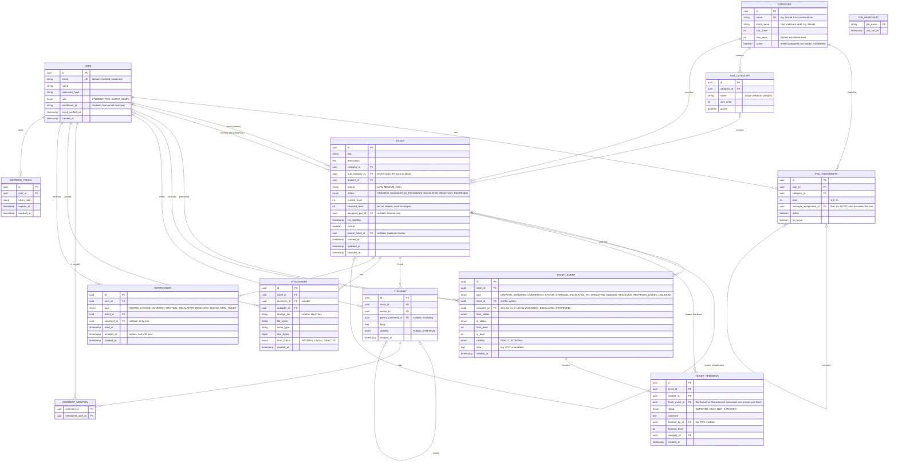

# ER diagram (database schema draft)

Draft for Sprint 0 review. Renders on GitHub. Types are indicative; exact column types are decided in the first migration.

## Design decisions

| Decision | Why |
| --- | --- |
| Two-level categories: `CATEGORY` (11 main, including "Other") and `SUB_CATEGORY` (57) | Students pick a topic then what exactly it is; POCs are assigned per main category, while analytics can drill into sub-categories. Retired categories are marked inactive because old tickets still point at them. |
| `role` is only STUDENT, POC or SUPER_ADMIN; level lives on `POC_ASSIGNMENT` | A POC's level and category can change without changing their account, and one person can in theory cover more than one category. |
| `manager_assignment_id` links an L1 assignment to its L2 | This is what lets an L2 see only the L1 team they oversee (the rollup and nudge features). |
| `assigned_poc_id` is on the ticket but never exposed to students | Students get a team label built from `category` and `current_level`. Student response models have no POC fields at all (NFR-02). |
| `TICKET_EVENT` is append-only with a `visibility` flag | Satisfies the audit requirement; INTERNAL events (nudges, "POC on leave" notes) are never selected by student queries. |
| `visibility` on `COMMENT` as well | Supports POC-to-POC internal comments hidden from the student. |
| `resolved_level` on the ticket | Reopen returns the ticket to the level that resolved it. |
| `NOTIFICATION.emailed_at` | Acts as the outbox: the worker sends pending notifications and stamps the time, so email can be added without changing ticket code. |
| `parent_ticket_id` | Duplicate linking: children mirror the master's status and level. |
| `ATTACHMENT.scan_status` | Files are not visible until the antivirus scan marks them CLEAN. |
| `JOB_HEARTBEAT` | The monitoring alert fires if the escalation job has not recorded a run in 15 minutes. |

## Indexes planned (NFR-17)

- `ticket(status, current_level, tat_deadline)` for the escalation job and POC dashboards
- `ticket(student_id, created_at)` for "My Tickets"
- `ticket(category_id, status)` for queues and analytics
- `ticket_event(ticket_id, created_at)` for timelines, `ticket_event(created_at)` for analytics date ranges
- `comment(ticket_id, created_at)`, `notification(user_id, read_at)`
- `pg_trgm` index on `ticket(title, description)` for duplicate suggestions

## Open points to confirm

1. Can one POC hold assignments in more than one category? The schema allows it.
2. Decided: students do not set `priority`. The column stays (default MEDIUM) for POCs to use later; students never send or see it.
3. Retention: how long are tickets, attachments and events kept?
