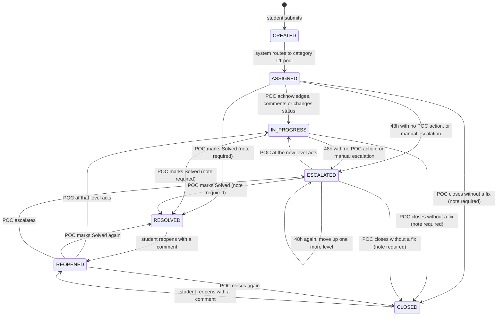

# Ticket state diagram

Source of truth for ticket lifecycle rules (PRD section 6). Renders on GitHub.

## Rules not visible in the diagram

| Rule | Detail |
| --- | --- |
| Level is separate from status | `current_level` (1, 2, 3...) changes on escalation; `status` is one of the states above. Students see only a team label, never the level or the person. |
| TAT clock | `tat_deadline` = time of assignment to the current level + 48h. Reset on every escalation and on reopen. Reassigning within a level does not reset it. |
| What counts as action | A POC comment, status change or resolution at the current level. A student comment, a view or a nudge does not. |
| Top level breach | At the highest configured level the ticket does not move. It gets `critical = true` and the Super Admin is notified. |
| Finishing | A POC must pick one outcome and write a note: **Solved** (`RESOLVED`, shown as "Solved"), **Closed** (`CLOSED`, no fix: invalid, duplicate, not possible) or **Escalated** (moves up one level, stays open). Solved and Closed notes are shown to the student; an escalation's reason is staff-only. Finished tickets cannot be changed. |
| Reopen | Only the ticket's own student can reopen a Solved or Closed ticket, and must write a comment (shown on the timeline as "You"). It returns to the level that finished it (`resolved_level`) with the least-loaded POC there; if nobody is on duty it goes one level up; if nobody at all, the reopen is refused. The 48h clock restarts. It can be reopened again later. **Exception: a ticket finished by the highest level (L3) is final and cannot be reopened**; the student sees "This outcome is final." |
| Duplicates | A linked ticket (`parent_ticket_id` set) mirrors its master's status and level. Reopening a linked ticket detaches it. |
| Audit | Every transition writes one `ticket_event` row in the same database transaction. Events are append-only. |
