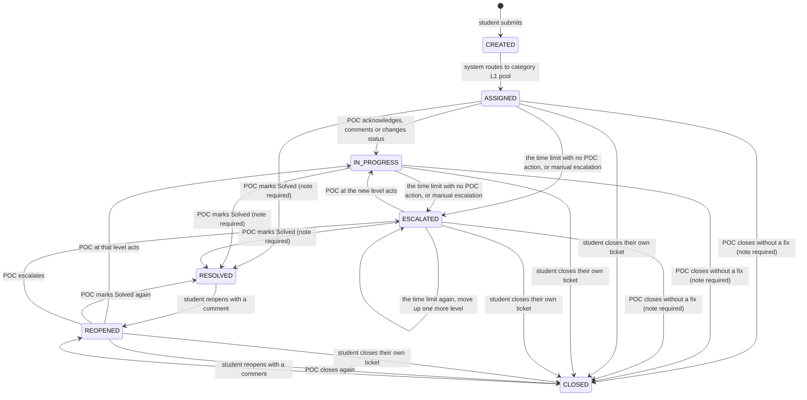

# Ticket state diagram

The ticket lifecycle as the API implements it. Renders on GitHub. A ticket the student closes themselves is marked `closed_by_student` and is not counted as a POC outcome.

## Rules not visible in the diagram

| Rule | Detail |
| --- | --- |
| Level is separate from status | `current_level` (1, 2, 3...) changes on escalation; `status` is one of the states above. Students see only a team label, never the level or the person. |
| Automatic escalation | A check runs every 15 minutes inside the API on a server that stays running (and once at start, to catch up after downtime). On serverless hosting there is no such timer, so a schedule calls `POST /internal/escalation/run` instead (hourly in the provided workflow); see DEPLOY.md. A ticket whose deadline has passed means its assigned POC did nothing for the time limit, because every POC action restarts the clock. It moves up to the next level that has someone on duty, gets a fresh the time limit, and is recorded as two events: `TAT_BREACHED` (internal, held against the POC who did nothing) and `ESCALATED` with `reason = TAT_BREACH` and no actor. At the top level the ticket is flagged `critical` instead, the admins are notified, and the clock stops until a POC acts. Safe to run twice or from several processes (`FOR UPDATE SKIP LOCKED`). Students only ever see "Escalated to <team>". A POC is also warned 12h before the deadline. |
| TAT clock | `tat_deadline` = time of assignment to the current level + the time limit. Reset on every escalation and on reopen. Reassigning within a level does not reset it. |
| What counts as action | A POC comment, status change or resolution at the current level. A student comment, a view or a nudge does not. |
| Top level breach | At the highest configured level the ticket does not move. It gets `critical = true`, and a `CRITICAL` notification row is written for each admin (see "Alerts" in the README: notification rows are not yet shown or emailed). |
| Finishing | A POC must pick one outcome and write a note: **Solved** (`RESOLVED`, shown as "Solved"), **Closed** (`CLOSED`, no fix: invalid, duplicate, not possible) or **Escalated** (moves up one level, stays open). Solved and Closed notes are shown to the student; an escalation's reason is staff-only. Finished tickets cannot be changed. |
| Reopen | Only the ticket's own student can reopen a Solved or Closed ticket, and must write a comment (shown on the timeline as "You"). It returns to the level that finished it (`resolved_level`) with the least-loaded POC there; if nobody is on duty it goes one level up; if nobody at all, the reopen is refused. The the time limit clock restarts. It can be reopened again later. **Exception: a ticket finished by the highest level (L3) is final and cannot be reopened**; the student sees "This outcome is final." |
| Self-close | The ticket's own student can close it at any time while it is open. It leaves the POC's queue, is recorded as `CLOSED_BY_STUDENT`, and can still be reopened. Analytics never count it as a POC Solved or Closed. |
| Duplicates | Not implemented yet. `parent_ticket_id` and the `LINKED` / `UNLINKED` events are reserved for it. |
| Audit | Every transition writes one `ticket_event` row in the same database transaction. Events are append-only. |
